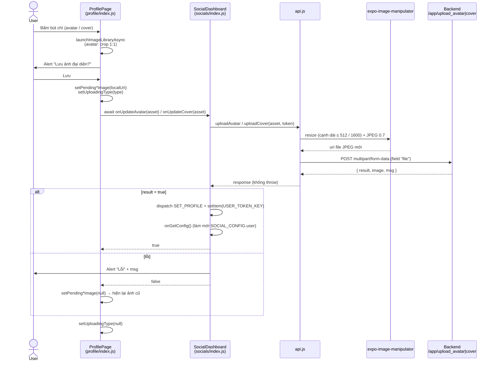

# Upload Photo — Flow avatar & ảnh bìa

> Phạm vi: upload **avatar** và **ảnh bìa (cover)** của người dùng.  
> File liên quan: `src/fetcher/api.js`, `src/components/home/socials/index.js`, `src/components/home/socials/profile/index.js`, `src/pages/edit-information.js`.  
> Luồng ảnh CCCD (dùng chung resize) và các luồng upload ảnh khác liệt kê ở [mục 7](#7-các-luồng-upload-ảnh-khác-ngoài-phạm-vi).

---

## 1. Điểm vào (entry points)

| Màn hình | Thao tác | Hàm xử lý | Trạng thái |
|---|---|---|---|
| Socials → mở profile của chính mình (`onShowOwnerProfile`) | Bấm bút chì ở avatar / ảnh bìa | `ProfilePage.handlePickImage(type)` | **Đang dùng** |
| Edit Information (`EditInformationScreen`) | Bấm nút upload avatar | `pickImage()` | Nút đang bị **comment** trong JSX → chưa dùng được |

Nút sửa chỉ hiện khi `isOwner === true`:

```js
const isOwner = !!userProfile.user_id && userProfile.user_id === SOCIAL_CONFIG?.user?.user_id;
```

Xem profile người khác → không có nút sửa, chỉ có Theo dõi / Nhắn tin / Chặn.

## 2. Sơ đồ luồng (Socials)



## 3. Chi tiết từng bước

### 3.1. Chọn ảnh — `ProfilePage.handlePickImage(type)`

```js
ImagePicker.launchImageLibraryAsync({
    mediaTypes: ['images'],
    allowsEditing: isAvatar,          // avatar cho crop
    aspect: isAvatar ? [1, 1] : undefined,
    quality: 1                        // nén ở bước resize, không nén 2 lần
});
```

- Bị chặn nếu đang upload (`uploadingType` khác `null`).
- Ảnh được chọn truyền **nguyên object asset** (`uri`, `width`, `height`, `fileName`, `mimeType`) xuống tầng dưới, không chỉ `uri`.

### 3.2. Xác nhận & hiển thị tạm — `confirmSaveImage(type, imageUri, file)`

- Alert xác nhận *Huỷ / Lưu*.
- Bấm **Lưu**:
  1. `setPendingAvatarImage(uri)` / `setPendingCoverImage(uri)`: hiện ảnh local ngay (optimistic).
  2. `setUploadingType(type)`: icon bút chì đổi thành `ActivityIndicator`, nút bị disable.
  3. `await onUpdateAvatar(file)` / `onUpdateCover(file)`.
  4. Kết quả `false` hoặc exception → reset pending về `null` (quay lại ảnh server cũ).
  5. `finally` → `setUploadingType(null)`.

### 3.3. Resize & tạo FormData — `createResizedImageFormData(file, prefix, maxSize)` (`api.js`)

| Tham số | Avatar | Cover |
|---|---|---|
| `prefix` | `avatar` | `cover` |
| `maxSize` (cạnh dài, px) | 512 | 1600 |

- Nhận asset **hoặc** chuỗi uri.
- Dùng API mới của `expo-image-manipulator` 14:
  `ImageManipulator.manipulate(uri)` → `resize(...)` (chỉ khi ảnh lớn hơn `maxSize` và biết `width/height`) → `renderAsync()` → `saveAsync({ compress: 0.7, format: JPEG })`.
- Part gửi lên:

  ```js
  { uri: <jpeg uri>, name: `${prefix}_${timestamp}.jpg`, type: 'image/jpeg' }
  ```

- **Fallback** khi resize lỗi: gửi ảnh gốc với `name = fileName || ${prefix}_${timestamp}.jpg`, `type = mimeType || 'image/jpeg'`.

### 3.4. Gọi API — `uploadAvatar` / `uploadCover`

| | Avatar | Cover |
|---|---|---|
| URL | `POST ${API_HOST}/app/upload_avatar` | `POST ${API_HOST}/app/upload_cover` |
| `API_HOST` | `https://app.aioglobal.org/api/mobile` | ← |
| Header | `Authorization: Bearer <profile.token>`, `Content-Type: multipart/form-data` | ← |
| Body | FormData, field `file` | ← |
| Timeout | 60 s | 60 s |

Gửi qua `makeFormRequest` (axios). **Không throw**: lỗi mạng/HTTP trả về `{ success: false, msg }`.

**Response mong đợi từ backend:**

```json
{ "result": true, "image": "<URL ảnh mới>", "msg": "..." }
```

> ⚠️ Chưa xác minh `image` là URL tuyệt đối hay đường dẫn tương đối. App dùng thẳng `profile.avatar` làm `uri` ở `account.js`, `socials/toolbar`, `socials/create`, `digital-wallet/account-info.js`, nên backend **cần trả URL tuyệt đối**.

### 3.5. Lưu kết quả — `SocialDashboard.saveUploadedImage(response, field)`

- `result` falsy → `Alert('Lỗi', msg)` → trả `false`.
- Thành công:
  1. `newProfile = { ...profile, [field]: image }` (`field` = `avatar` | `coverPhoto`).
  2. `dispatch({ type: 'SET_PROFILE', payload: newProfile })`: cập nhật global state, mọi màn hình dùng `profile.avatar` re-render.
  3. `setItem(USER_TOKEN_KEY, JSON.stringify(newProfile))`: lưu SecureStore, giữ ảnh mới sau khi khởi động lại app.
  4. `onGetConfig()`: tải lại `SOCIAL_CONFIG.user` (`avtar`, `cover`), để mở lại profile thấy ảnh mới.
  5. Trả `true`.

## 4. Luồng Edit Information — `pickImage()`

Giống luồng Socials nhưng gọn hơn, tự xử lý kết quả ngay trong màn hình:

1. Chọn ảnh (`['images']`, crop 1:1).
2. Lưu ảnh cũ (`previousImage`), hiện ảnh local.
3. `uploadAvatar(asset, token)`.
4. Thành công → `setImage(resp.image)`, `dispatch SET_PROFILE`, `setProfile(newProfile)` (hook `useProfile`, lưu `USER_TOKEN_KEY`), báo `lang.success`.
5. Thất bại → `setImage(previousImage)`, báo `lang.error` + `resp.msg`.

> Muốn bật lại: bỏ comment nút ở khối JSX avatar **và** import `Ionicons` từ `@expo/vector-icons` (hiện chưa import).

## 5. Trạng thái hiển thị ảnh trong `ProfilePage`

```js
source={{ uri: pendingAvatarImage ? pendingAvatarImage : returnImageUrl(userProfile.avatar) }}
```

- `pending*Image`: ảnh local trong lúc / sau khi upload, sống đến khi đóng ProfilePage.
- `returnImageUrl(url)`: trên Android đổi `https` → `http`; `url` rỗng thì dùng ảnh mặc định `profile.aioglobal.org/bg-lanscape.png`.
- `userProfile.avatar` lấy từ `SOCIAL_CONFIG.user.avtar` (prefix `https://aioglobal.com.vn` nếu không chứa `app.aioglobal.org`).

## 6. Checklist test thủ công

- [ ] Profile của mình: có nút sửa avatar + cover, **không** có Theo dõi / Nhắn tin / Chặn.
- [ ] Profile người khác: **không** có nút sửa.
- [ ] Đổi avatar thành công → ảnh mới hiện ở profile, toolbar Socials, màn Account.
- [ ] Kill app, mở lại → vẫn là avatar mới.
- [ ] Đóng rồi mở lại profile → vẫn là avatar mới.
- [ ] Tắt mạng rồi upload → hiện Alert lỗi, ảnh quay về ảnh cũ, nút bút chì bấm lại được.
- [ ] Ảnh lớn (> 4000px, HEIC trên iOS) → upload được, file gửi lên là JPEG ≤ 512px (kiểm tra ở server).
- [ ] Ảnh từ Android có `fileName = null` → tên file gửi lên là `avatar_<timestamp>.jpg`.
- [ ] Đổi ảnh bìa: tương tự, ảnh ≤ 1600px.
- [ ] Bấm bút chì liên tục khi đang upload → không mở picker lần 2.

## 7. Các luồng upload ảnh khác (ngoài phạm vi)

### 7.1. Ảnh CCCD (VNeID) — đã dùng chung resize

- Nơi gọi: `src/pages/indentity.js` → `pickImage()`.
- API: `uploadIdentityPhoto(asset, token)` → `POST ${API_HOST}/app/upload_vneid`, field `file`, timeout 60 s.
- Ảnh đi qua `createResizedImageFormData(file, 'vneid', 1600)`: cạnh dài ≤ 1600px để chữ/QR trên CCCD vẫn đọc được, JPEG 0.7.
- Picker: `mediaTypes: ['images']`, `allowsEditing: true`, `quality: 1`.
- Xử lý kết quả: `makeFormRequest` không throw, nên coi là **lỗi** khi response rỗng, `success === false` hoặc `result === false`. Khi lỗi thì quay lại ảnh trước đó và báo `lang.error` + `msg`. Ngược lại báo `lang.success`.

> ⚠️ Chưa xác minh format response thành công của `/app/upload_vneid`. Nếu backend báo lỗi bằng field khác (ví dụ `status: false`), cần bổ sung vào điều kiện kiểm tra.

### 7.2. Các luồng chưa rà soát

| Chức năng | Nơi gọi | Hàm API | Endpoint | Ghi chú |
|---|---|---|---|---|
| Chèn ảnh vào rich editor | `src/components/richeditor.js` | `uploadPhoto(uri)` | `/app/upload_photo` | `quality: 0.4`; response dùng `resp.url` |
| Ảnh bài đăng Socials | `src/components/home/socials/create/index.js` | `fetchSocial(...)` + FormData | `SOCIAL_CONFIG.url/...` | Upload qua API social |
| Ảnh KYC ví | `src/pages/digital-wallet/kyc.js` | `uploadFile(form)` (`digital-wallet/fetcher`) | API ví | Có xin quyền camera + thư viện |

`uploadPhoto` vẫn dùng helper `createFormData(uri, prefix)`: luôn gửi `name = ${prefix}_${timestamp}.jpg`, `type = image/jpeg` mà **không** convert ảnh. Nếu ảnh gốc là HEIC/PNG thì type khai báo sai. Có thể chuyển sang `createResizedImageFormData` khi cần.
